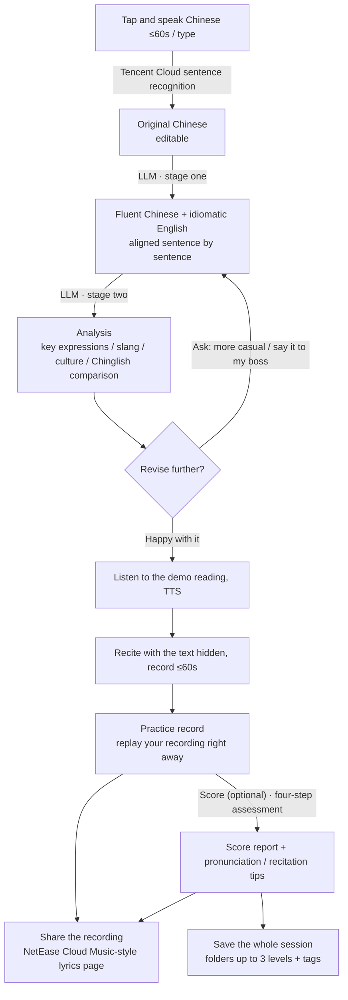
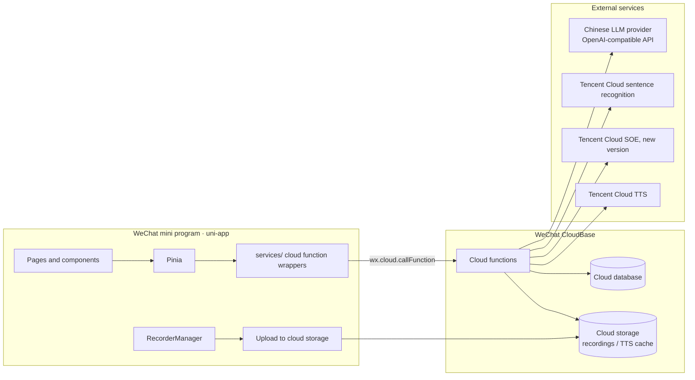

<div align="center">

# `🦜 solvane`

**Say it in Chinese, learn to say it in English**

[](LICENSE.md)
[](https://github.com/frankie137/solvane/actions/workflows/ci.yml)
[](CHANGELOG.md)
[](https://developers.weixin.qq.com/miniprogram/en/dev/framework/)
[](https://uniapp.dcloud.net.cn/)
[](https://vuejs.org/)
[](https://www.typescriptlang.org/)
[](https://developers.weixin.qq.com/miniprogram/en/dev/wxcloud/basis/getting-started.html)
[](#4-llm-configuration)

</div>

A WeChat mini program that turns what you want to say in Chinese into idiomatic English, then helps you recite it and get the pronunciation right.

Solvane takes the scattered Chinese you want to say but can't yet say in English and turns it into a fluent Chinese passage and an idiomatic, everyday-tone English version, with an analysis of key expressions, slang and cultural background. You can then recite the English, get a pronunciation score and tips, save the whole session into nested folders, or turn your recording into a lyrics page to share with friends.

The app's interface is in Chinese, because it is built for Chinese speakers learning English.

- **Form**: WeChat mini program (trial version, for a small circle of users)
- **Tech stack**: uni-app (Vue 3 + Vite + TypeScript + Pinia) + WeChat CloudBase
- **Status**: V1 (M0-M5) is complete; M6 (Pro membership, optional scoring) shipped as 1.1.0 and M7 (public release preparation) as 1.2.0; V2 is being planned (see [Development progress](#development-progress))

---

## Contents

- [Core flow](#core-flow)
- [Features](#features)
- [Architecture](#architecture)
- [Repository layout](#repository-layout)
- [Key design decisions](#key-design-decisions)
- [Data model](#data-model)
- [Design guidelines](#design-guidelines)
- [External services and configuration](#external-services-and-configuration)
- [Development progress](#development-progress)
- [Development and review process](#development-and-review-process)
- [Local development](#local-development)
- [Constraints and known limitations](#constraints-and-known-limitations)
- [Contributing](#contributing)
- [License](#license)

---

## Core flow



---

## Features

### 1. Expression generation (M1)

| Feature              | Description                                                                                                                                                                       |
| -------------------- | --------------------------------------------------------------------------------------------------------------------------------------------------------------------------------- |
| Voice input          | Tap once and start talking, up to 60 seconds per take; tap Done (「完成」) to transcribe (you can edit the text before submitting), or Cancel (「取消」) to discard the recording |
| Typed input          | For when speaking isn't convenient; switch between voice and typing at any time                                                                                                   |
| Chinese polish       | Turns scattered, colloquial Chinese into one fluent passage, keeping the original meaning and fixing recognition errors along the way                                             |
| Idiomatic English    | Everyday conversational tone: one main version plus 1-2 alternatives; Chinese and English aligned sentence by sentence                                                            |
| English level        | Middle school / high school / CET-4 / CET-6 / IELTS / TOEFL; only vocabulary and sentence complexity change, the tone stays conversational                                        |
| Accent               | American by default; switch to British in settings                                                                                                                                |
| Analysis             | Breakdown of key expressions, slang and idioms (with register and region), cultural background, Chinglish comparison, and one example sentence per key expression                 |
| Multi-round revision | Ask for changes conversationally; each revision creates a new version, and you can switch back to earlier versions                                                                |

### 2. Reading aloud and recitation assessment (M2)

| Feature               | Description                                                                                                                                                                  |
| --------------------- | ---------------------------------------------------------------------------------------------------------------------------------------------------------------------------- |
| Demo reading          | Tencent Cloud TTS with a male or female voice at 0.8x / 1.0x / 1.2x speed; each version is synthesized only once and cached                                                  |
| Recitation recording  | The text is hidden by default (tap to peek), up to 60 seconds, with a live waveform while recording; the recording can be replayed right after submitting (M6)               |
| Recitation assessment | Optional (M6): runs only when you tap Score (「评分」) and consumes one use (see [Membership](#6-membership-m6)); four-step assessment that accepts rephrasing               |
| Score report          | Overall score plus four sub-scores: pronunciation / fluency / content recall / expression correctness; color-coded words; pronunciation tips and recitation tips; replayable |
| Practice records      | Each session keeps the 3 most recent; a 4th pushes out the oldest (recordings that have been shared are not affected)                                                        |

### 3. Saved items and history (M3)

| Feature                  | Description                                                                                                                                                                                                                                                                                                           |
| ------------------------ | --------------------------------------------------------------------------------------------------------------------------------------------------------------------------------------------------------------------------------------------------------------------------------------------------------------------- |
| Save sessions            | The whole session: original Chinese, polished Chinese, every English version and revision request, analysis, practice records                                                                                                                                                                                         |
| Save expressions / words | Save with one tap next to key expressions and slang in the analysis; on the session page, long-press an English sentence to pick words, or tap a word in the score report. The LLM fills in the meaning based on the original sentence. Saving the same expression again merges into one card and adds the new source |
| Source tracing           | An expression card shows "Saved from" (「收藏自」): the English sentence it came from (highlighted), the session and the date; tap it to jump to that sentence in that version. It also shows "Also appears in" (「也出现在」): other uses found automatically in the English of all your sessions                    |
| Saved tab                | Split into Expressions (「表达」) and Sessions (「对话」), which share the same folders and tags                                                                                                                                                                                                                      |
| Folders                  | Up to 3 levels; create, rename, move, delete and reorder                                                                                                                                                                                                                                                              |
| Tags                     | Tag across folders and filter by tag                                                                                                                                                                                                                                                                                  |
| History                  | Every session is saved automatically and is searchable; saving a session means putting it in a folder                                                                                                                                                                                                                 |
| Review                   | Planned for V2: flashcards from saved expressions and words, with reviews scheduled along the forgetting curve                                                                                                                                                                                                        |

### 4. Sharing (M4)

| Feature        | Description                                                                                                                                                                              |
| -------------- | ---------------------------------------------------------------------------------------------------------------------------------------------------------------------------------------- |
| Share card     | Pick one practice recording (scored or not) and send it as a mini program card to a WeChat friend or group                                                                               |
| Lyrics player  | Modeled on NetEase Cloud Music: one line of English, one line of Chinese; the sentence being played is highlighted and scrolls smoothly to the center; tap a sentence to play from there |
| Shared content | Only the recording and the Chinese and English text, without scores or analysis                                                                                                          |
| Visibility     | Recipients must be trial members of the mini program                                                                                                                                     |

### 5. Settings (refined from M1 onward)

- English level, accent, and the voice and speed of the demo reading
- LLM settings (**admins only**): provider presets (DeepSeek / Qwen / Kimi / Zhipu / Doubao / Custom), API endpoint, API key, model name, with a Test connection button (「测试连接」)
- There is a single global configuration shared by all members; since M6, members can no longer enter their own

### 6. Membership (M6)

| Feature     | Description                                                                                                                                                                                                |
| ----------- | ---------------------------------------------------------------------------------------------------------------------------------------------------------------------------------------------------------- |
| Pro         | CNY 9.9/month: unlimited new sessions and scoring                                                                                                                                                          |
| Free uses   | 5 per person in total, never reset: creating a session (generating the first version) and scoring each use 1; revisions, recording, playback and sharing are free; failures don't count                    |
| Activation  | For now an admin grants it manually in Me → Membership management (「我的 → 会员管理」), 30 days at a time, extending the current expiry if it hasn't passed; mini program virtual payment will come later |
| Out of uses | Starting a new session or scoring shows the Pro intro, where you can copy your user ID to send to an admin; existing sessions and reports stay viewable                                                    |
| Admins      | Users listed in `ADMIN_OPENIDS` always count as Pro and can see every member's remaining uses and expiry date                                                                                              |

---

## Architecture



**Key points**

- All secrets (Tencent Cloud keys, LLM API keys) live only in cloud function environment variables or are encrypted before being stored in the database; **the frontend never sees them in plaintext**.
- Clients cannot read or write any database collection directly. All access goes through cloud functions, which check permissions by `OPENID`.
- Cloud functions are written in TypeScript, with shared code in `cloud/src/lib`, and each function is bundled separately with esbuild, which makes the code easy to reuse and unit test.
- API types shared by the frontend and backend live in `shared/`, and both sides import them from there to keep the API from drifting.

### Cloud functions

| Cloud function | Responsibilities                                                                                                                                                                    | Timeout | Status |
| -------------- | ----------------------------------------------------------------------------------------------------------------------------------------------------------------------------------- | ------- | ------ |
| `compose`      | Create sessions, generate (the first version consumes a free use), revise, analyze, fill in meanings for saved expressions; LLM settings (admins only)                              | 60s     | ✅ M6  |
| `speech`       | Chinese speech recognition (the recording is deleted after recognition); demo reading synthesized per sentence and cached; reference pronunciation of words and phrases             | 20s     | ✅ M3  |
| `data`         | Learning preferences, reading sessions, recent sessions, switching versions; folders, saved items, tags, source tracing, history and search; sharer profile and sharing; membership | 10s     | ✅ M6  |
| `assess`       | Store recitation recordings; on-demand scoring (recognize → align → assess → report, consumes a use); recognition and alignment only, for sharing; keep the latest 3                | 60s     | ✅ M6  |

Each function dispatches on an `action` field, and the input and output of every action are registered in `shared/api.ts`.

---

## Repository layout

```
solvane/
├── src/                          # Mini program frontend (uni-app)
│   ├── pages/index/              # Main package: app shell, one page hosting the three tabs
│   │   ├── index.vue             #   Tab switching and transitions, ?tab= opens a tab directly
│   │   └── tabs/                 #   Practice / Saved / Me
│   ├── pkg-dev/                  # Subpackage: component preview (development version only)
│   ├── pkg-session/              # Subpackage: session detail (sentence pairs, analysis, version switching, revision bar)
│   ├── pkg-settings/             # Subpackage: LLM settings (admins only)
│   ├── pkg-admin/                # Subpackage: membership management (admins only)
│   ├── pkg-recite/               # Subpackage: recitation (masking and progressive hints, demo reading, recording), practice records and score reports
│   ├── pkg-library/              # Subpackage: folders, expression cards and source tracing, all sessions (history and search)
│   ├── pkg-share/                # Subpackage: lyrics player (sentence and word highlighting, share card cover), my shares
│   ├── components/sv-*/          # Base components: nav bar, tab bar, button, card, list, skeleton, icon
│   ├── components/profile/       # Avatar and nickname sheet (shared by the Me tab and the share entry)
│   ├── components/pro/           # Pro intro sheet (shared by the Me tab, new session and scoring)
│   ├── components/library/       # Shared library components: folder picker, tag editor, saved lists, saved toast (used by several subpackages, so kept in the main package)
│   ├── components.d.ts           # Global type registrations for sv-* components
│   ├── composables/              # Composables
│   ├── services/                 # Cloud function call wrapper (callCloud)
│   ├── stores/                   # Pinia stores
│   ├── styles/                   # Design tokens (light / dark) and global styles
│   ├── utils/                    # Pure utility functions
│   └── App.vue / main.ts / pages.json / manifest.json / theme.json
├── cloud/                        # Cloud function source (TypeScript)
│   ├── src/functions/<name>/     #   index.ts entry (wires real dependencies) + handlers.ts business logic
│   ├── src/lib/                  #   Routing, data access, LLM, encryption, audio, Tencent Cloud (ASR / TTS / SOE)
│   ├── src/prompts/              #   Prompt templates
│   └── tests/                    #   Unit tests (in-memory database + fake LLM)
├── shared/                       # Shared by frontend and backend: API contracts, domain types, constants, response envelope, expression matching
├── scripts/
│   ├── build-cloud.ts            #   Bundles cloud functions into cloudfunctions/ with esbuild
│   ├── mp-ci.ts                  #   Preview QR code, trial version upload, cloud function deployment (miniprogram-ci)
│   └── smoke.ts                  #   Smoke test: drives WeChat DevTools and screenshots each page
├── docs/
│   ├── REVIEW.md                 #   Development and review process, review checklist
│   └── stages/                   #   Per-stage task lists and review records
├── .github/workflows/ci.yml      # Runs pnpm check on push and PR
├── project.config.json           # WeChat DevTools config: just open the repository root
├── CHANGELOG.md                  # Per-stage change notes
├── CLAUDE.md                     # Collaboration conventions
├── LICENSE.md                    # PolyForm Noncommercial License 1.0.0
└── README.md
```

Build output in `dist/` (mini program) and `cloudfunctions/` (cloud functions) is not committed.

---

## Key design decisions

### 1. Recitation assessment pipeline

What you say while reciting can differ from the original (a rephrasing, half a sentence left out), so the assessment can neither compare rigidly against the original nor rely on the transcript alone. It runs in four steps. Each step writes its result to the database and the frontend advances them one at a time, because a single cloud function call can't fit the whole flow:

| Step         | What it does                                                                                                                                                                  | Output                                                                                            |
| ------------ | ----------------------------------------------------------------------------------------------------------------------------------------------------------------------------- | ------------------------------------------------------------------------------------------------- |
| 1. Recognize | Convert the recording to WAV and archive it; English sentence recognition (`16k_en`, with word-level timestamps)                                                              | The words actually spoken and the time of each word                                               |
| 2. Align     | The LLM compares "what you said" with the original, reconstructs "the sentence you meant to say" for each sentence, and classifies every difference                           | Per sentence: reconstructed text and time range; list of differences; content recall; correctness |
| 3. Assess    | Cut the recording into per-sentence clips and assess them in parallel with pronunciation assessment (new version) in sentence mode, using the reconstructed text as reference | Accuracy and phoneme issues for each word; overall accuracy, fluency and completeness             |
| 4. Report    | The LLM combines all of the above                                                                                                                                             | Overall score, one-line summary, pronunciation tips, recitation tips                              |

> The original design used the free-speech mode of pronunciation assessment for step 1. Testing showed that mode returns neither timestamps nor phonemes, so English speech recognition is used instead. Only the sentence mode of pronunciation assessment (≤30 words) returns phonemes and timing, which is why step 3 splits the recording by sentence.

How step 2 classifies differences:

- **Misread**: the recognized word sounds close to the word in the original (e.g. think → sink); treated as a pronunciation problem, not a content error
- **Rephrased**: the meaning is right and the wording is idiomatic; no content penalty
- **Omitted / added**: counts against content recall
- **Grammar error**: counts against correctness

Scoring weights (to be tuned after real-world testing):

| Dimension      | Weight | Source                                                                      |
| -------------- | ------ | --------------------------------------------------------------------------- |
| Pronunciation  | 40%    | Accuracy from step 3                                                        |
| Fluency        | 20%    | Fluency from step 3                                                         |
| Content recall | 25%    | Step 2: whether the key expressions were recited, share of omissions        |
| Correctness    | 15%    | Step 2: whether rephrasings are idiomatic, whether there are grammar errors |

The word-level timings from step 1 also power "listen to this part of your recording" in the report and the lyric sync on the share page.

**Optional scoring (M6)**: when a recording is submitted, the PCM is only converted to WAV and stored (so it can be replayed right away); nothing is recognized or scored. Each practice record moves toward a goal (`practiceGoal`):

- Tap Score (「评分」): consumes one free use and runs all four steps; on failure the scoring request is withdrawn, the use is refunded, and the record goes back to Recorded (「录好了」)
- Share without scoring: runs only step 1 (recognize) and step 2 (align) to get the lyric timings, without consuming a use; word-by-word highlighting uses the word timings from recognition
- Share first, score later: picks up from step 3 without recognizing again

### 2. Two-stage generation

LLM generation is split into two calls and the page shows each part as it arrives, which shortens the perceived wait and stays clear of cloud function timeouts:

1. **Stage one**: polished Chinese + main English version + alternatives + sentence-by-sentence Chinese/English alignment
2. **Stage two**: analysis (key expressions, slang, culture, Chinglish comparison, example sentences)

Both stages require the LLM to output JSON, which the cloud function validates against a schema. A parse failure is retried once automatically; if it still fails, a readable error is returned.

For a revision, the current version and the revision request are sent to the LLM together, and once the new version is generated its analysis is filled in the same way.

### 3. Generation jobs and timeouts

The mini program stops waiting for a cloud function call after about 15 seconds, while LLM generation can take longer. So:

- The results of generation requests (generate / revise / analyze) are **written to the database first**. If the frontend gets no response in time, it polls the session state every 2 seconds, for up to 70 seconds.
- Each session runs only one job at a time, locked with a conditional update in the database (job lock). A job that has run for more than 70 seconds is treated as interrupted and can be started again.
- When a job fails, its error code and message are written to the session's `lastError`, so the polling side gets the same error.
- Each job has a 55-second budget (the cloud function timeout is 60 seconds, leaving 5 seconds for database reads and writes), and LLM requests and retries all finish within it.

### 4. LLM configuration

- All major Chinese providers offer OpenAI-compatible APIs, so there is a single generic client, and switching providers is just a matter of "endpoint + model name".
- There is one global configuration, set by an admin and shared by all members (since M6). When it isn't configured, admins see a prompt to set it up and members see "the admin hasn't configured it yet" (「管理员还没有配置」). Configurations that members saved earlier are cleared when an admin opens the settings page.
- API keys are encrypted with AES-256-GCM before being stored, with the encryption key in a cloud function environment variable; the frontend only sees a masked value such as `sk-****abcd`.
- The endpoint must be a public https domain, so the cloud function can't be used to reach internal networks.
- If a provider doesn't support JSON mode, the request is retried automatically without that parameter. Responses are validated against a schema; if one fails, the problems are fed back to the model for one round of correction.
- User input is explicitly marked in the prompt as "content to process" and is never followed as instructions.
- Admins are listed in the cloud function environment variable `ADMIN_OPENIDS`.

### 5. Lyrics player

- The Chinese/English sentence pairs are produced by the LLM, sentence by sentence, when it generates the English, and are stored in the version data.
- Timeline: the word timings from step 3 of the assessment are mapped onto the original sentences through the alignment from step 2, which gives each sentence a start and end time; if the mapping fails, times are estimated in proportion to word counts. For unscored recordings, the words recognized in step 1 are assigned to sentences by the sentences' time ranges.
- Sharing creates a **snapshot** (sentences, timeline, recording, the sharer's nickname and avatar), so later changes to the session don't affect what was shared.
- Recordings are kept in private cloud storage; when the share page opens, a cloud function exchanges them for temporary URLs.

### 6. Reserving and refunding free uses

- A use is reserved at the start with a conditional database update (incremented only if `freeUsed < 5`), so concurrent requests can't take more than one; the reservation is recorded on the session or practice record (`freeCharged`).
- If the job fails, the flag is cleared and the use refunded. If a job is interrupted (timed out) and retried, the flag is still set and no new use is taken.
- Creating a session only checks the balance without reserving (so no empty session is created when uses have run out); the use is actually reserved when the first version is generated. Scoring reserves a use when Score (「评分」) is tapped.
- Pro users and admins never consume uses. When Pro expires, the user goes back to the free tier and continues with whatever uses remain.

### 7. Recording cleanup rules

- Voice input recordings are only used for recognition and are deleted right after it.
- Once a session has 3 practice records, adding another deletes the oldest; its recording file is deleted too unless a share snapshot references it, in which case the file is kept.
- When a share is deleted, its recording file is deleted if no practice record or other share references it anymore.

---

## Data model

Every collection is readable and writable only by cloud functions. `_openid` is the user who owns the data.

| Collection    | Main fields                                                                                                                                                                                                                            | Status |
| ------------- | -------------------------------------------------------------------------------------------------------------------------------------------------------------------------------------------------------------------------------------- | ------ |
| `settings`    | `_id` (openid or `__global__`), `level`, `accent`, `ttsVoice`, `ttsSpeed`, `llm{preset, baseUrl, model, apiKeyCipher, apiKeyMask, updatedAt}` (only on `__global__`), `profile{nickname, avatarFileID}`                                | ✅ M6  |
| `sessions`    | `_openid`, `title`, `input{mode, rawText}`, `polishedZh`, `versions[]`, `currentVid`, `job`, `lastError`, `starredAt`, `folderId`, `tags[]`, `freeCharged`, `createdAt`, `updatedAt`                                                   | ✅ M6  |
| `practices`   | `_openid`, `sessionId`, `vid`, `stage`, `scoreRequested`, `timingRequested`, `freeCharged`, `job`, `lastError`, `pcmFileID`, `wavFileID`, `durationMs`, `transcript`, `alignment`, `pronunciation`, `report`, `createdAt`, `updatedAt` | ✅ M6  |
| `folders`     | `_openid`, `name`, `parentId`, `depth` (1-3), `order`, `createdAt`                                                                                                                                                                     | ✅ M3  |
| `expressions` | `_openid`, `text`, `key` (merge key), `kind` (phrase / slang / word), `meaning`, `usage`, `example`, `note`, `fill`, `fillStartedAt`, `folderId`, `tags[]`, `sources[]`, `createdAt`, `savedAt`, `updatedAt`                           | ✅ M3  |
| `shares`      | `_openid`, `sessionId`, `practiceId`, `title`, `sentences[]{en, zh, startMs, endMs, words[]}`, `audioFileID` (copy of the recording), `durationMs`, `author{nickname, avatarFileID}`, `createdAt`                                      | ✅ M4  |
| `accounts`    | `_id` (openid), `freeUsed`, `proUntil`, `grants[]{action, until, by, at}`, `createdAt`, `updatedAt`                                                                                                                                    | ✅ M6  |

Collections are created automatically by the cloud functions on first write. We recommend setting every collection's permission in the CloudBase console to "no user can read or write" (「所有用户不可读写」), so that all access goes through cloud functions.

`sessions` also has a server-only `tts` field (version → voice and speed → audio file and word timings for each sentence), which is never sent to the frontend.

Job fields on `sessions`:

- `job`: the running job `{ kind: 'generate' | 'revise' | 'analyze', vid, startedAt }`, or `null` when no job is running
- `lastError`: the most recent failure `{ kind, vid, code, message, at }`, cleared on success

Each entry of `sessions.versions[]` (type definitions in `shared/types.ts`):

```ts
{
  vid: string                     // v1, v2, ...
  instruction: string | null      // revision request for this version; null for the first version
  en: string                      // full text of the main English version
  sentences: { en: string; zh: string }[]
  alternatives: { label: string; en: string }[]   // alternative phrasings; label describes the tone
  analysis: {                     // generated in stage two; null until then
    keyPhrases: { phrase: string; meaning: string; usage: string; example: string }[]
    slang: { phrase: string; meaning: string; register: string; region: string }[]
    culture: { topic: string; note: string }[]
    chinglish: { literal: string; natural: string; why: string }[]
  } | null
  createdAt: number
}
```

---

## Design guidelines

Style keywords: **techy, minimal, clean**, taking Apple's visual and interaction design as the reference.

| Item          | Guideline                                                                                         |
| ------------- | ------------------------------------------------------------------------------------------------- |
| Theme         | Light / dark follows the system; every color is defined as a CSS variable                         |
| Background    | Light: `#F5F5F7` base with white cards; dark: `#000000` base with `#1C1C1E` cards                 |
| Accent        | Blue-purple gradient for primary buttons, the record button and highlighted lyrics                |
| Typography    | System fonts (PingFang SC / SF Pro); English body text slightly larger than Chinese               |
| Corner radius | Three sizes: 12 / 16 / 24                                                                         |
| Navigation    | Custom nav bar with a large title that collapses on scroll; frosted-glass tab bar                 |
| Motion        | Durations 200 / 300 / 450ms; main easing `cubic-bezier(0.32, 0.72, 0, 1)`; scale to 0.97 on press |
| Loading       | Skeleton with a shimmer sweep, no spinners                                                        |
| Feedback      | Light haptics on key actions (recording start / stop, successful save)                            |

---

## External services and configuration

### Services to enable

| Service                                                   | Purpose                                                      | Billing       |
| --------------------------------------------------------- | ------------------------------------------------------------ | ------------- |
| WeChat CloudBase                                          | Cloud functions, database, storage                           | Plan-based    |
| Tencent Cloud sentence recognition (「一句话识别」)       | Chinese speech to text (≤60s)                                | Pay-as-you-go |
| Tencent Cloud SOE, new version (「智聆口语评测（新版）」) | Pronunciation assessment for recitation                      | Pay-as-you-go |
| Tencent Cloud TTS (「语音合成」)                          | Demo reading                                                 | Pay-as-you-go |
| A Chinese LLM provider (your choice)                      | Polish, translation, analysis, revision, assessment analysis | Pay-as-you-go |

### Cloud function configuration

Each cloud function's timeout and required environment variables are defined in `cloud/src/function-config.ts`:

| Cloud function | Timeout | Environment variables                                                                                                                                       |
| -------------- | ------- | ----------------------------------------------------------------------------------------------------------------------------------------------------------- |
| `compose`      | 60s     | `KEY_ENCRYPTION_SECRET` (encrypts API keys; generated automatically if left empty), `ADMIN_OPENIDS` (admin user IDs)                                        |
| `speech`       | 20s     | `TENCENT_SECRET_ID` / `TENCENT_SECRET_KEY` (Tencent Cloud sub-account keys: speech recognition, TTS)                                                        |
| `data`         | 10s     | `ADMIN_OPENIDS` (membership management)                                                                                                                     |
| `assess`       | 60s     | `TENCENT_SECRET_ID` / `TENCENT_SECRET_KEY` (also need SOE permission), `SOE_APP_ID` (Tencent Cloud account AppID), `KEY_ENCRYPTION_SECRET`, `ADMIN_OPENIDS` |

**How to set them**: fill in the local file `.keys/cloud.env` (template in `cloud.env.example`), then run:

```bash
pnpm cloud:config
```

The script sets each function's timeout, pushes only the variables that function needs, and reads them back to verify. Safety measures:

- `.keys/` is not tracked by git; a pre-push hook blocks the push if a key file has been added to version control
- The file must have mode 600 (read and write by its owner only), or the script refuses to run; the first run creates an empty template with mode 600
- The script never prints any values; it only reports that they were verified
- Once `KEY_ENCRYPTION_SECRET` has been generated, don't change or delete it, or saved API keys can no longer be decrypted and have to be entered again
- You can copy a user ID by tapping Me → User ID (「我的 → 用户 ID」) in the mini program, or run `pnpm cloud:fill-admin` to fill it in automatically

`pnpm cloud:config` authenticates with the code upload key. The upload key can deploy cloud functions; keep it in `.keys/` (mode 600, not in git) and reset it in the WeChat MP console if you suspect a leak. You can also set each function's timeout and environment variables by hand in the CloudBase console.

You also need to declare the personal information the app uses in the WeChat MP console under Settings → Service declarations → User privacy protection guidelines (「设置 → 服务内容声明 → 用户隐私保护指引」), otherwise WeChat blocks the corresponding features: microphone (voice input, recitation), avatar and nickname from the user's profile (sharer attribution), clipboard (copying English, copying the user ID).

---

## Development progress

| Stage  | Scope                                                                                                                     | Acceptance criteria                                                                     | Status     |
| ------ | ------------------------------------------------------------------------------------------------------------------------- | --------------------------------------------------------------------------------------- | ---------- |
| Design | Requirements discussion, technology choices, this document                                                                | Design finalized                                                                        | ✅ Done    |
| M0     | Environment, scaffolding, linting and tests, cloud function build, design tokens and base components, review process docs | A blank home page runs in WeChat DevTools and all checks pass                           | ✅ Done    |
| M1     | Voice / typed input → polish → English + analysis → multi-round revision; settings page and LLM settings                  | Say some Chinese, get English and an analysis, and keep revising                        | ✅ Done    |
| M2     | Demo reading, recitation recording, four-step assessment, score report, practice records                                  | After one recitation, see the sub-scores and pronunciation tips                         | ✅ Done    |
| M3     | Saving sessions, saving expressions / words with source tracing, folders, tags, history and search                        | Save an expression and trace it to its sentence; create, move and find folders          | ✅ Done    |
| M4     | Share card, lyrics player                                                                                                 | A trial member opens the card, hears the recording, and the lyrics scroll in sync       | ✅ Done    |
| M5     | Motion polish, empty and error states, performance and package size, real-device acceptance                               | The full flow runs smoothly on a real device                                            | ✅ Done    |
| M6     | Pro membership and free uses, manual activation by admins; optional scoring; LLM uses the global configuration only       | Playback and sharing work without scoring; the Pro intro appears when free uses run out | ✅ Done    |
| M7     | Public release preparation: noncommercial license, English docs and comments, operational details removed                 | `pnpm check` passes and UI text and LLM prompts are unchanged                           | ✅ Done    |
| V2     | Review: flashcards from saved expressions and words, with reviews scheduled along the forgetting curve                    | -                                                                                       | 📋 Planned |

Detailed notes for each stage are in [CHANGELOG.md](CHANGELOG.md).

---

## Development and review process

Every stage follows the same process (full checklist in [docs/REVIEW.md](docs/REVIEW.md)):

1. **Before starting**: write the stage's task list and acceptance criteria in `docs/stages/M<n>.md`
2. **Development**: on a dedicated branch `stage/m<n>-<topic>`
3. **Automated checks** (all must pass): `pnpm check`, which covers formatting, ESLint, TypeScript type checking (templates included), Vitest unit tests, the mini program build and the cloud function build; GitHub Actions runs the same checks
4. **Code review**: an independent review agent goes over every change in the stage, looks for correctness problems, and works through the project checklist item by item (secrets and logs, database permissions, timeouts and error handling, package size, UI guidelines); every finding is either fixed or given a written reason for not fixing it
5. **Smoke test**: run the key flows through the WeChat DevTools automation API and take screenshots; then the owner does acceptance testing with the trial version on a real device
6. **Merge**: merge into `main` through a GitHub PR, tag a version, update the development progress in this document, and add the stage to [CHANGELOG.md](CHANGELOG.md)

---

## Local development

**Requirements**: Node.js 24 LTS, pnpm 12, WeChat DevTools

**First-time setup**

```bash
pnpm install
```

To use a specific CloudBase environment, copy `.env.example` to `.env.local` and set `VITE_CLOUD_ENV`; if it's left empty, the mini program's default environment is used.

**Day-to-day development**

```bash
pnpm dev
```

Then open the **repository root** (not `dist/`) in WeChat DevTools. Code changes are recompiled automatically.

**Upload, preview and deploy cloud functions (without opening WeChat DevTools)**

This uses WeChat's official [miniprogram-ci](https://developers.weixin.qq.com/miniprogram/dev/devtools/ci.html), which needs a code upload key:

1. In the WeChat MP console, generate and download the key under Management → Development management → Development settings → Mini program code upload (「管理 → 开发管理 → 开发设置 → 小程序代码上传」)
2. Put it at `.keys/private.<appid>.key` (ignored by git), or point to it with the `WX_PRIVATE_KEY_PATH` environment variable
3. In the same place, add your machine's public IP to the whitelist

Cloud functions created by the deploy tool run on Node.js 16.13, so the code is bundled for Node 16; dependencies are installed in the cloud at deploy time.

If the IP whitelist blocks you (a home broadband public IP can change), use `pnpm deploy:cloud:devtools` instead: it deploys through WeChat DevTools, needs no upload key and is not subject to the whitelist. If WeChat DevTools isn't running, it is started in the background; leave it open afterward.

**Common commands**

| Command                       | Purpose                                                                                                                                                             |
| ----------------------------- | ------------------------------------------------------------------------------------------------------------------------------------------------------------------- |
| `pnpm dev`                    | Development build (watch mode), output to `dist/mp-weixin`                                                                                                          |
| `pnpm build`                  | Production build                                                                                                                                                    |
| `pnpm build:cloud`            | Bundle cloud functions into `cloudfunctions/`                                                                                                                       |
| `pnpm test`                   | Unit tests                                                                                                                                                          |
| `pnpm check`                  | Required before committing: formatting, linting, types, tests, builds                                                                                               |
| `pnpm smoke`                  | Smoke test (WeChat DevTools must be logged in, with the service port enabled under Settings → Security (「设置 → 安全设置」))                                       |
| `pnpm preview`                | Generate a preview QR code at `.ci/preview.png` to scan with a phone (works for the mini program's admins and developers)                                           |
| `pnpm upload`                 | Upload as the development version; the first time, set it as the trial version in the WeChat MP console, after which uploads update the trial version automatically |
| `pnpm deploy:cloud:devtools`  | Deploy all cloud functions through WeChat DevTools, not subject to the IP whitelist                                                                                 |
| `pnpm deploy:cloud [name...]` | Bundle and deploy cloud functions; the environment ID comes from `--env` or from `VITE_CLOUD_ENV` in `.env.local`                                                   |

---

## Constraints and known limitations

- **Trial version only**: users and share recipients must all be trial members of the mini program (an individually registered mini program allows about 15; the WeChat MP console has the exact limit). There are no plans to submit it for review and public release.
- **Voice input and recitation recordings**: up to 60 seconds per take.
- **LLM**: for now only Chinese providers with an OpenAI-compatible API are supported.
- **Payments**: membership is a virtual good, so it can only use mini program virtual payment (「小程序虚拟支付」), not regular WeChat Pay; an individually registered mini program must first complete verification and ICP filing, and its service categories must include Tools (「工具」). For now admins grant membership manually.
- **Network**: assessment and generation depend on cloud services and don't work offline.

---

## Contributing

Bug reports and suggestions are welcome in [Issues](https://github.com/frankie137/solvane/issues). Pull requests are not accepted for now.

## License

Solvane is source-available under the [PolyForm Noncommercial License 1.0.0](LICENSE.md). Personal, research, educational and nonprofit use is allowed; commercial use is not. For a commercial license, contact the author via [GitHub](https://github.com/frankie137).
