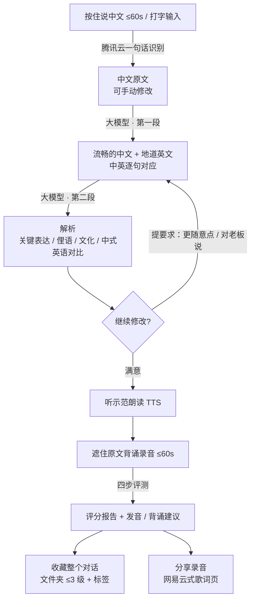
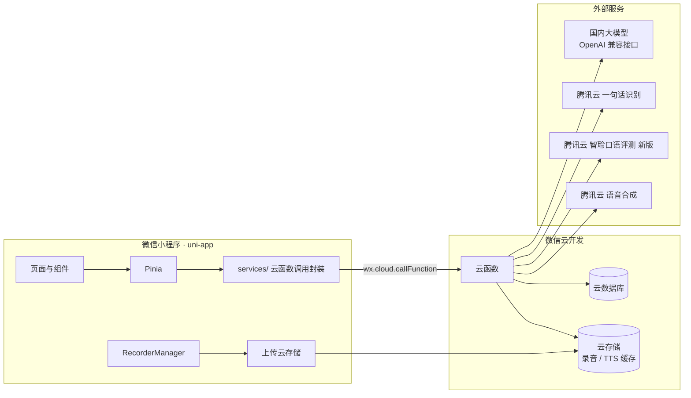

# Solvane

> 用母语说出想法，学会地道的英文表达，再背出来、练准发音的微信小程序。

Solvane 把"想说但不会说"的零碎中文，变成一段流畅的中文、一段日常口吻的地道英文，并附带关键表达、俚语和文化背景的解析。之后你可以背诵这段英文、拿到发音评分和建议，把整个对话收藏进分级文件夹，或者把录音做成歌词页分享给朋友。

- **形态**：微信小程序（体验版，仅供小圈子使用）
- **技术栈**：uni-app（Vue 3 + Vite + TypeScript + Pinia）+ 微信云开发
- **状态**：设计已定稿，准备进入 M0（见 [开发进度](#开发进度)）

---

## 目录

- [核心流程](#核心流程)
- [功能模块](#功能模块)
- [技术架构](#技术架构)
- [仓库结构](#仓库结构)
- [关键设计](#关键设计)
- [数据模型](#数据模型)
- [设计规范](#设计规范)
- [外部服务与配置](#外部服务与配置)
- [开发进度](#开发进度)
- [开发与审查流程](#开发与审查流程)
- [本地开发](#本地开发)
- [约束与已知限制](#约束与已知限制)

---

## 核心流程



---

## 功能模块

### 1. 表达生成（M1）

| 功能 | 说明 |
|---|---|
| 语音输入 | 按住说话，单次最长 60 秒，录完转文字，可手动修改后再提交 |
| 打字输入 | 不方便说话时用，和语音输入可随时切换 |
| 中文润色 | 把零碎、口语化的中文整理成一段流畅表达，保留原意，顺带纠正识别错误 |
| 地道英文 | 日常对话口吻，主推一版 + 1～2 个备选说法；中英按句一一对应 |
| 英语水平 | 初中 / 高中 / 四级 / 六级 / 雅思 / 托福，只调整用词和句式难度，口吻始终是日常对话 |
| 口音偏好 | 默认美式，可在设置里切换英式 |
| 解析 | 关键表达拆解、俚语与习语（标注语体和地域）、文化背景、中式英语对比、每个关键表达一个例句 |
| 多轮修改 | 对话式提要求；每次修改生成一个新版本，可切回历史版本 |

### 2. 朗读与背诵评测（M2）

| 功能 | 说明 |
|---|---|
| 示范朗读 | 腾讯云语音合成，可选男声/女声、0.8x / 1.0x / 1.2x 语速；同一版本只合成一次并缓存 |
| 背诵录音 | 默认遮住原文（可点按偷看），最长 60 秒，录音时显示实时波形 |
| 背诵评测 | 四步评测（见 [关键设计](#1-背诵评测流水线)），允许换说法，不只比对转写文本 |
| 评分报告 | 总分 + 发音 / 流利度 / 内容还原度 / 表达正确性四项；逐词标色；发音建议和背诵建议；可回放 |
| 练习记录 | 每个对话保留最近 3 次，第 4 次挤掉最旧的一次（已分享的录音不受影响） |

### 3. 收藏与历史（M3）

| 功能 | 说明 |
|---|---|
| 收藏内容 | 整个对话：中文原文、润色中文、所有英文版本和修改要求、解析、练习记录 |
| 文件夹 | 最多 3 级，可新建、重命名、移动、删除，支持排序 |
| 标签 | 跨文件夹打标签，按标签筛选 |
| 历史 | 所有对话自动保存，可搜索；收藏 = 放进某个文件夹 |
| 复习 | 第二版再做（闪卡 / 定期复习） |

### 4. 分享（M4）

| 功能 | 说明 |
|---|---|
| 分享卡片 | 选一次练习录音，以小程序卡片发给微信好友或群 |
| 歌词播放页 | 仿网易云：英文一行、中文一行；播放到哪句哪句高亮并平滑滚到中间；点某句跳到那里播放 |
| 分享内容 | 只包含录音和中英原文，不含分数和解析 |
| 可见范围 | 接收人需是小程序的体验成员 |

### 5. 设置（M1 起逐步完善）

- 英语水平、口音、示范朗读的音色和语速
- 大模型配置：服务商预设（DeepSeek / 通义千问 / Kimi / 智谱 / 豆包 / 自定义）、接口地址、API Key、模型名，带"测试连接"
- 管理员额外可设置**全局默认**大模型配置，其他成员不配置时使用它；成员也可以填自己的配置覆盖

---

## 技术架构



**要点**

- 所有密钥（腾讯云密钥、大模型 Key）只存在于云函数环境变量或加密后存入数据库，**前端永远拿不到明文**。
- 数据库所有集合禁止客户端直接读写，一律经云函数访问，云函数按 `OPENID` 做权限校验。
- 云函数用 TypeScript 编写，共享代码放在 `cloud/src/lib`，用 esbuild 按函数分别打包，便于复用和单元测试。
- 前后端共用的接口类型放在 `shared/`，两边都从这里引用，避免接口漂移。

### 云函数划分

| 云函数 | 职责 | 超时 |
|---|---|---|
| `compose` | 中文润色、英文生成、解析、多轮修改 | 60s |
| `speech` | 中文语音识别、示范朗读合成（含缓存） | 20s |
| `assess` | 背诵评测流水线、练习记录管理 | 60s |
| `data` | 对话、文件夹、标签、设置、分享、用户的增删改查 | 10s |

函数内部按 `action` 字段分发，函数数量保持精简。

---

## 仓库结构

> 以下为规划结构，M0 搭建后按实际情况更新。

```
solvane/
├── src/                        # 小程序前端（uni-app）
│   ├── pages/                  # 主包：三个 tab 页
│   │   ├── practice/           #   练习（首页）：输入区 + 最近对话
│   │   ├── library/            #   收藏：文件夹树 + 标签 + 搜索
│   │   └── me/                 #   我的：个人信息、设置入口、历史
│   ├── pkg-session/            # 分包：对话详情、修改、版本切换
│   ├── pkg-recite/             # 分包：背诵录音、评分报告、练习记录
│   ├── pkg-share/              # 分包：歌词播放页
│   ├── pkg-settings/           # 分包：设置、大模型配置
│   ├── components/             # 通用组件（导航栏、卡片、录音按钮、波形……）
│   ├── composables/            # 组合式函数（录音、播放、动画……）
│   ├── services/               # 云函数调用封装
│   ├── stores/                 # Pinia 状态
│   ├── styles/                 # 设计变量（浅色 / 深色）与全局样式
│   ├── App.vue / main.ts / pages.json / manifest.json
├── cloud/                      # 云函数源码（TypeScript）
│   ├── src/functions/          #   compose / speech / assess / data
│   ├── src/lib/                #   大模型客户端、腾讯云客户端、数据库、加密、鉴权
│   ├── src/prompts/            #   提示词模板
│   └── tests/                  #   云函数单元测试
├── cloudfunctions/             # 云函数打包产物（由 cloud/ 构建生成，上传用）
├── shared/                     # 前后端共用的类型与常量
├── docs/
│   ├── REVIEW.md               #   代码审查清单与流程
│   └── stages/                 #   各阶段的任务清单与验收记录
├── CLAUDE.md                   # 给 AI 协作者的项目约定
└── README.md
```

---

## 关键设计

### 1. 背诵评测流水线

背诵时说出来的内容可能和原文不同（换了说法、漏了半句），所以既不能拿原文硬比，也不能只看转写文本。评测分四步：

| 步骤 | 做什么 | 产出 |
|---|---|---|
| ① 自由说评测 | 口语评测"自由说"模式，不给参考文本 | 实际说出的词 + 每个词的声学发音分 |
| ② 对齐与还原 | 大模型对齐"实际说的"和"原文"，给每处差异分类 | 差异列表 + "你想说的那句话" |
| ③ 精细评测 | 以"你想说的那句话"为参考文本，用句子 / 段落模式再评一次 | 单词和音素级发音问题、完整度、每个词的时间位置 |
| ④ 汇总报告 | 大模型综合以上结果 | 四项分数、发音建议、背诵建议 |

第 ② 步的差异分类：

- **读错了**：识别结果和原文的词读音相近（如 think → sink），按发音问题处理，不算内容错误
- **换了说法**：意思正确、表达地道，不扣内容分
- **漏说 / 多说**：计入内容还原度
- **语法错误**：计入表达正确性

评分权重（M2 实测后再调）：

| 维度 | 权重 | 来源 |
|---|---|---|
| 发音 | 40% | 第 ③ 步的精准度 |
| 流利度 | 20% | 第 ③ 步的流利度 |
| 内容还原度 | 25% | 第 ② 步：关键表达是否背出、漏说比例 |
| 表达正确性 | 15% | 第 ② 步：换的说法是否地道、有无语法错误 |

第 ③ 步得到的单词时间位置，同时用于分享页的歌词同步。

### 2. 两段式生成

大模型生成拆成两次调用，页面逐段呈现，缩短体感等待，也避开云函数超时：

1. **第一段**：润色后的中文 + 英文主推版 + 备选说法 + 中英逐句对应
2. **第二段**：解析（关键表达、俚语、文化、中式英语对比、例句）

两段都要求大模型输出 JSON，云函数用 schema 校验；解析失败自动重试一次，仍失败则返回可读错误。

多轮修改时，把当前版本和修改要求一起发给大模型，生成新版本后同样再补一次解析。

### 3. 大模型配置

- 所有国内主流服务商都提供 OpenAI 兼容接口，因此只实现一个通用客户端，靠"接口地址 + 模型名"切换服务商。
- 读取顺序：成员自己的配置 → 管理员设置的全局默认 → 未配置时提示去设置。
- API Key 用 AES-GCM 加密后存库，加密密钥放在云函数环境变量；前端只能看到 `sk-****abcd` 这样的打码值。
- 管理员身份由云函数环境变量 `ADMIN_OPENIDS` 指定。

### 4. 歌词播放页

- 每句的中英对应在生成英文时就由大模型按句给出，存在版本数据里。
- 时间轴：用评测第 ③ 步的单词时间位置，按第 ② 步的对齐结果映射到每句原文，得到每句的起止时间；映射失败时按词数比例估算。
- 分享时生成一份**快照**（句子、时间轴、录音、分享者昵称头像），之后修改对话不影响已分享的内容。
- 录音文件存私有云存储，打开分享页时由云函数换取临时链接。

### 5. 录音文件的清理规则

- 练习记录满 3 条后，最旧的一条被删除；如果它的录音没有被任何分享快照引用，录音文件一起删除，否则保留。
- 删除分享时，若录音已不被任何练习记录或分享引用，则删除录音文件。

---

## 数据模型

所有集合的权限均为"仅云函数可读写"。`_openid` 为数据所属用户。

| 集合 | 主要字段 |
|---|---|
| `users` | `_id`(openid)、`nickname`、`avatarUrl`、`createdAt` |
| `settings` | `_id`(openid 或 `__global__`)、`level`、`accent`、`ttsVoice`、`ttsSpeed`、`llm{preset, baseUrl, model, apiKeyCipher, apiKeyMask}` |
| `sessions` | `_openid`、`title`、`input{mode, rawText, audioFileID}`、`polishedZh`、`versions[]`、`currentVid`、`folderId`、`tags[]`、`createdAt`、`updatedAt` |
| `practices` | `_openid`、`sessionId`、`vid`、`audioFileID`、`durationMs`、`scores{overall, pronunciation, fluency, content, expression}`、`diffs[]`、`words[]`、`sentenceTimings[]`、`feedback`、`createdAt` |
| `folders` | `_openid`、`name`、`parentId`、`depth`(1–3)、`order` |
| `shares` | `_id`(shareId)、`_openid`、`sessionId`、`practiceId`、`snapshot{sentences, timings, audioFileID, author}`、`createdAt` |

`sessions.versions[]` 的每一项：

```ts
{
  vid: string
  instruction?: string            // 本次修改要求，首版为空
  en: string                      // 英文主推版全文
  sentences: { en: string; zh: string }[]
  alternatives: string[]          // 备选说法
  analysis?: {                    // 第二段生成，可能稍后才有
    keyPhrases: { phrase: string; meaning: string; usage: string; example: string }[]
    slang: { phrase: string; meaning: string; register: string; region: string }[]
    culture: { topic: string; note: string }[]
    chinglish: { literal: string; natural: string; why: string }[]
  }
  ttsFileID?: string              // 示范朗读缓存
  createdAt: number
}
```

---

## 设计规范

风格关键词：**科技、简洁、干净**，参考 Apple 的视觉和交互。

| 项目 | 规范 |
|---|---|
| 主题 | 浅色 / 深色跟随系统，全部颜色用 CSS 变量定义 |
| 背景 | 浅色 `#F5F5F7` 底 + 白色卡片；深色 `#000000` 底 + `#1C1C1E` 卡片 |
| 强调色 | 蓝紫渐变，用于主按钮、录音按钮、高亮歌词 |
| 字体 | 系统字体（PingFang SC / SF Pro），英文正文略大于中文 |
| 圆角 | 12 / 16 / 24 三档 |
| 导航 | 自定义导航栏，大标题随滚动收起；tab 栏毛玻璃 |
| 动效 | 时长 200 / 300 / 450ms；主曲线 `cubic-bezier(0.32, 0.72, 0, 1)`；按下缩放 0.97 |
| 加载 | 骨架屏 + 微光扫过，不用菊花 |
| 反馈 | 关键操作轻微震动（录音开始 / 结束、收藏成功） |

---

## 外部服务与配置

### 需要开通的服务

| 服务 | 用途 | 计费 |
|---|---|---|
| 微信云开发 | 云函数、数据库、存储 | 按套餐 |
| 腾讯云 一句话识别 | 中文语音转文字（≤60s） | 按量 |
| 腾讯云 智聆口语评测（新版） | 背诵发音评测 | 按量 |
| 腾讯云 语音合成 | 示范朗读 | 按量 |
| 国内大模型（任选） | 润色、翻译、解析、修改、评测分析 | 按量 |

### 云函数环境变量

在云开发控制台配置，**不进入代码仓库**：

| 变量 | 说明 |
|---|---|
| `TENCENT_SECRET_ID` / `TENCENT_SECRET_KEY` | 腾讯云子账号密钥，只授权识别、评测、合成三项 |
| `SOE_APP_ID` | 口语评测（新版）的应用 ID |
| `KEY_ENCRYPTION_SECRET` | 加密大模型 API Key 用的密钥 |
| `ADMIN_OPENIDS` | 管理员 openid，多个用逗号分隔 |

---

## 开发进度

| 阶段 | 内容 | 验收标准 | 状态 |
|---|---|---|---|
| 设计 | 需求讨论、技术选型、本文档 | 设计定稿 | ✅ 完成 |
| M0 | 环境、脚手架、代码检查与测试、云函数构建、设计变量与基础组件、审查流程文档 | 开发者工具中跑起空白首页，所有检查通过 | ⏳ 待开始 |
| M1 | 语音 / 打字输入 → 润色 → 英文 + 解析 → 多轮修改；设置页与大模型配置 | 说一段中文，得到英文和解析，并能继续修改 | ⏳ |
| M2 | 示范朗读、背诵录音、四步评测、评分报告、练习记录 | 背一遍后看到分项分数和发音建议 | ⏳ |
| M3 | 文件夹、标签、收藏、历史与搜索 | 能建文件夹、移动、收藏、查找 | ⏳ |
| M4 | 分享卡片、歌词播放页 | 体验成员打开卡片能听录音，歌词同步滚动 | ⏳ |
| M5 | 动效打磨、空状态与错误状态、性能与包体积、真机验收 | 真机全流程顺畅 | ⏳ |
| V2 | 复习（闪卡 / 定期复习） | — | 📋 规划中 |

---

## 开发与审查流程

每个阶段都走同一套流程（完整清单见 `docs/REVIEW.md`，M0 中创建）：

1. **开工前**：在 `docs/stages/` 写下本阶段的任务清单与验收标准
2. **开发**：在独立分支 `stage/<阶段>-<主题>` 上进行
3. **自动检查**（必须全部通过）：ESLint、TypeScript 类型检查、Vitest 单元测试、小程序构建、云函数构建
4. **代码审查**：独立的审查代理检查本阶段全部改动，查正确性问题，并按项目清单逐条过（密钥与日志、数据库权限、超时与错误处理、包体积、UI 规范）；每条发现要么修复，要么写明不修的理由
5. **冒烟测试**：用开发者工具自动化接口跑关键流程并截图；再由你在真机体验版验收
6. **合并**：通过 GitHub PR 合并到 `main`，打版本标签，更新本文档的开发进度

---

## 本地开发

> M0 完成后补全具体命令。

**环境要求**：Node.js 24 LTS、pnpm、微信开发者工具

```bash
pnpm install
```

```bash
pnpm dev:mp-weixin
```

开发模式启动后，用微信开发者工具打开构建输出目录即可预览。

---

## 约束与已知限制

- **仅体验版**：使用者和分享接收人都必须是小程序的体验成员（个人主体上限约 15 人，以公众平台后台为准）。不计划提交审核上线。
- **语音输入和背诵录音**：单次最长 60 秒。
- **大模型**：暂时只支持提供 OpenAI 兼容接口的国内服务商。
- **网络**：评测和生成都依赖云端服务，离线不可用。
